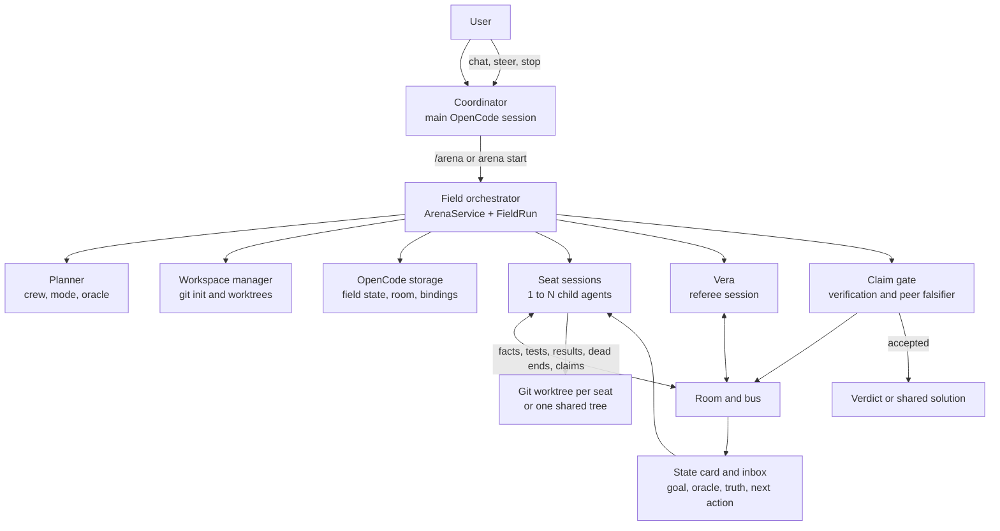

# Arena in plain English

Arena turns one OpenCode session into a small team that works on one goal at the
same time. The team talks in one shared room, checks each other's claims, and keeps
working until the work is proven or every agent decides to leave.

This file is the friendly tour. The technical reference is
[docs/architecture.md](docs/architecture.md) and
[docs/field-design.md](docs/field-design.md).

## The one-sentence version

Arena is a continuous room of child AI sessions, each with a name and a point of
view, coordinated by a referee and closed by evidence instead of a round counter.

## The 30-second version

- You start a **field** with an objective and, optionally, a verification command.
- The **orchestrator** plans the crew, creates one child session per seat, creates
  Vera the referee, prepares the workspaces, and opens the room.
- Every **seat** gets the same contract, the roster, a small state card, and the
  rules for taking a lease before it writes or launches.
- Seats post **facts**, **tests**, **results**, **dead ends**, **requests** and
  **claims** into one public room.
- The room delivers messages at each agent's next safe point, not as an interrupt.
- A **claim** goes through the **gate**: the verification command runs, one idle
  peer tries to falsify the claim, and the claim must carry evidence.
- A normal field closes when a valid claim is accepted. A **same-role** room treats
  the accepted solution as a shared result and stays live.
- Every agent leaves by its own decision. A leave is permanent. Only you can stop
  the field or force an agent out.

## The cast

| Name | What it is | What it does |
|---|---|---|
| You | The user | Start the field, talk to the coordinator, steer, stop, force a leave |
| Coordinator | The main OpenCode session you already talk to | Calls the Arena tools, watches the room, names an owner, stays out of the work |
| Field orchestrator | The plugin service and the field driver | Plans, creates sessions, runs the tick, stores state, enforces the gate |
| Seats | Child OpenCode sessions, one per agent | Work the whole problem or a lane, post evidence, leave when done |
| Vera | A child session that acts as referee | Reads the board, pulses a quiet room, reports, recommends abort, never assigns work |
| Room | One public conversation | All messages are visible; there are no private messages |
| Bus | The typed message system | Facts, tests, results, oracles, claims, asks, handoffs, dead ends, lessons |
| State card | A compact status board injected into each turn | Goal, oracle, current facts, refuted routes, running experiment, next action |
| Inbox | A per-agent queue | Batches room messages and delivers them at a safe point |
| Gate | The claim checker | Runs verification, asks a peer to falsify, requires evidence |
| Workspace | The files a seat edits | A git worktree per seat, or one shared tree when isolation is unsafe |
| Seal | A permanent leave marker | A sealed session cannot be woken by any message or resume |
| Arena tab | The desktop panel | Shows the crew, room, facts, experiments and controls |

## A run, step by step

1. **Start.** You use `/arena`, the `arena` tool, or a plain-language request. The
   objective, success criteria, verification command and optional crew go in.
2. **Plan.** The orchestrator reads the brief, chooses the coordination mode
   (`split`, `race`, `hybrid` or `independent`), picks or accepts the crew, and
   chooses the oracle, which is the one observation that decides the task.
3. **Prepare.** It makes the working directory a git repository if it has none,
   creates worktrees when the root is safe to isolate, creates one child session per
   seat plus Vera, and opens the field state and room.
4. **Kickoff.** Each seat receives the contract, the roster, its role, the state
   card and the rules. A seat starts with the whole problem, not a tiny task.
5. **Work.** A seat reads the room, takes a lease before a write or launch, runs
   one experiment per resource, and posts a fact or result when it learns
   something. There is no round counter and no per-agent step budget.
6. **Talk.** The room batches messages by priority. User orders steer first, a
   named mention waits one flush, peer facts wait two. A busy agent gets the batch
   at its next safe point; an idle agent gets it immediately.
7. **Claim.** A seat that believes the goal is met posts a claim with evidence. If
   the contract has a verification command, the orchestrator runs it. One idle peer
   runs the cheapest check that could disprove the claim.
8. **Gate.** The claim is accepted only when verification passes, the peer does not
   falsify it, and the evidence is present. A reject returns the claimer to work
   with the reason. There is no fake success.
9. **Close or share.** A normal field posts a verdict and closes. A same-role room
   shares the accepted solution and stays live until every agent leaves or you stop
   it.
10. **Leave.** An agent leaves by its own decision, stops its jobs, and is sealed
    forever. The field ends when every agent has left. Only you can stop it early.

## The drawing

GitHub renders this Mermaid diagram. The text drawing below is the fallback.



```text
+--------+      +-----------------------------+
|  User  |----->| Coordinator (main session)  |
+--------+      +--------------+--------------+
                               |
                               v
                 +-----------------------------+
                 | Field orchestrator          |
                 | plan, sessions, storage     |
                 +--+--------+--------+--------+
                    |        |        |
        +-----------+        |        +-----------+
        v                    v                    v
+---------------+   +---------------+    +---------------+
| Seat 1        |   | Seat 2 ... N  |    | Vera          |
| child agent   |   | child agent   |    | referee       |
+-------+-------+   +-------+-------+    +-------+-------+
        |                   |                    |
        +---------+---------+----------+---------+
                  |                    |
                  v                    v
          +---------------+    +---------------+
          | Room + bus    |    | Git worktrees |
          | facts, claims |    | per seat      |
          +-------+-------+    +---------------+
                  |
                  v
          +---------------+
          | State card    |
          | + inbox       |
          +---------------+
```

## The five tools

Arena adds these tools to any agent that may use tools. No agent file is required.

| Tool | What it is for |
|---|---|
| `arena` | Plan, start, inspect, steer, stop, read, consume, finish, report, list |
| `arena_bus` | Post and read room messages: take, release, fact, test, result, oracle, claim, ask, answer, handoff, dead-end, lesson, leave |
| `arena_fs` | Read, list, stat, status, diff, write, copy, remove, merge inside the workspace |
| `arena_git` | Status, diff, log, commit, merge, abort, resolve for copy-on-write branches |
| `arena_exec` | Run a command or launch in the workspace under the lock and lease rules |
| `arena_job` | List, status, output and stop background jobs |
| `arena_spawn` | Start one bounded child agent from a seat, depth limited |

The `/arena` command is a shortcut for starting a field from the text after the
command. `arena` with `action: "start"` is the tool form.

## The gate in one paragraph

A claim is not a vote. The orchestrator runs the contract's verification command
when one is declared, records the real output, and asks one idle peer to falsify
the claim with a cheap check. The claim is accepted only when the verification
passes (or no command was declared), the peer does not falsify it, and the claim
carries evidence. Two rejected claims close that claim. Vera may report or
recommend an abort, but she cannot accept a claim by hand or force a close.

## The rules that matter

- **One room.** There are no private messages. Every routed message is also
  written to the target's transcript as an `[arena.room]` note.
- **Continuous.** No rounds, no phases, no per-agent step budget, no default
  deadline. A field can stay quiet; it does not close itself.
- **User owns termination.** Only you can stop the field or force an agent to
  leave. The coordinator cannot.
- **Leave is forever.** A sealed session cannot be woken by a user, a peer, a
  mention, or a resume.
- **Leases.** A write or a launch takes an area lease first. A second owner is
  refused before the tool runs. Two tests on the same resource serialize; different
  resources can run in parallel.
- **Evidence, not summaries.** Structured facts, tests, results, oracles, claims
  and dead ends carry up to 64,000 characters; the inbox batch budget is 256,000.
  Raw command output and raw records are kept, not redacted.
- **No target gate.** Any host, URL or IP named in the brief is work to do. Network
  access is always on.
- **Workspaces are real git.** A non-git working directory is initialized in place
  with an `arena baseline` commit. A safe project root gets one worktree per seat;
  a home/drive root or an unusable root stays shared or falls back to a shadow
  repository.

## What is not in this folder

Arena is a plugin, not a standalone model server. The folder does not contain:

- **OpenCode itself.** Arena runs inside an OpenCode 2.2 or newer host. That is
  the agent runtime, the session manager and the model connector.
- **A model or a provider account.** OpenCode connects to the provider you
  configured; Arena does not ship a model or an API key.
- **Bun.** Bun is the package manager and test runner for development, and the
  runtime OpenCode uses. Install Bun separately.
- **Git.** Git is used for worktrees and merges. On Windows the plugin downloads
  the official MinGit build into its own tools folder if git is missing. On macOS
  and Linux, install git normally.
- **Any MCP server, browser tool, Python package or Docker container.** Arena needs
  none of them. With `toolPolicy: "all"`, a seat can use whatever tools the host
  exposes, but that is the host's toolbox, not an Arena dependency.
- **The built GUI file in git.** The setup script runs `bun run build:gui` inside
  the installed copy and creates `dist/gui-experimental.cjs` there. The core tools
  and the room work without the tab.

Everything the Arena plugin itself needs is in this repo. The setup script copies
the runtime into OpenCode at `~/.config/opencode/plugins/arena`, installs its
dependencies and builds the tab there. The clone is the source, not the runtime;
moving or deleting the clone does not break the installed copy.

## Where the code lives

| Path | What is inside |
|---|---|
| `src/core/` | Pure field state, inbox, gate, knowledge and report logic. No OpenCode imports |
| `src/field/` | Roster, prompts, the continuous `FieldRun` driver, leases and experiments |
| `src/host/` | The host port and the OpenCode adapter |
| `src/service.ts` | Rooms, sessions, storage, resume, the field registry |
| `src/plugin.ts` | OpenCode entry: tools, slash command, hooks, RPC, service cache |
| `src/workspace.ts` | Git repository preparation, worktrees, diff, merge and verification |
| `src/git.ts` | Git discovery and the Windows MinGit bootstrap |
| `src/gui.tsx` | The Arena tab |
| `test/` | Field, room, service, plugin, workspace and gate tests |
| `docs/` | The technical design documents |
| `skills/arena/` | The optional skill that makes the natural-language trigger discoverable |

## Glossary

- **Field:** one Arena run. It has one objective, one room and one set of seats.
- **Seat:** one agent in the field. A seat has a name, a role and a brief.
- **Lane:** an owned part of a split or race field. A same-role room has no lanes.
- **Oracle:** the observation that decides whether the goal is met, plus its
  baseline.
- **Lease:** a temporary claim on an area or resource, so two seats do not write or
  launch the same thing at once.
- **Fact:** a structured claim with evidence, stored on the board.
- **Claim:** a request to close the goal, checked by the gate.
- **Seal:** the permanent record that a session has left.
- **Vera:** the referee. She watches, asks one question when the room is quiet, and
  reports; she does not assign work.

## Read next

- [README.md](README.md) for the short install and a usage example.
- [GUIDE.md](GUIDE.md) for the full command, tool and settings reference.
- [docs/architecture.md](docs/architecture.md) for the host-neutral design and the
  tick loop.
- [docs/field-design.md](docs/field-design.md) for the state card, gate, leases,
  persistence and failure behavior.
- [docs/porting.md](docs/porting.md) to run the same field on a different host.
